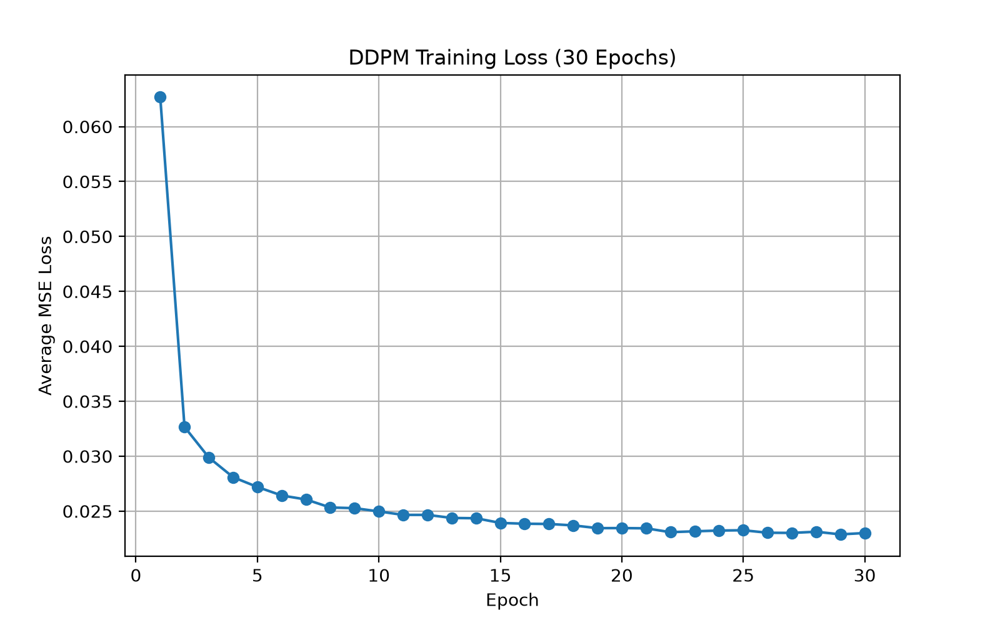
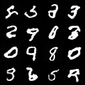
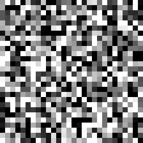
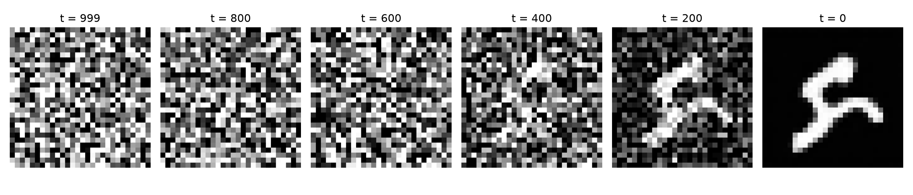
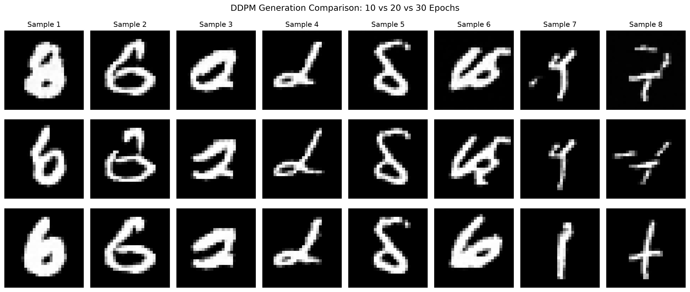
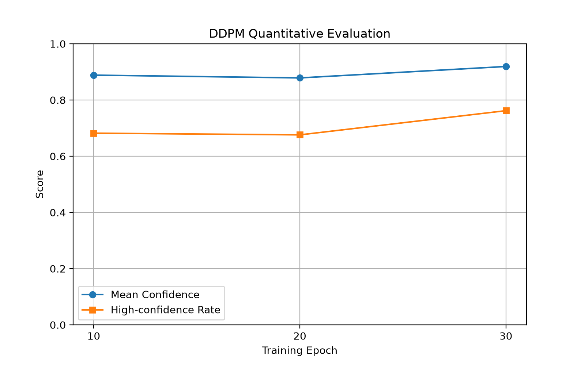
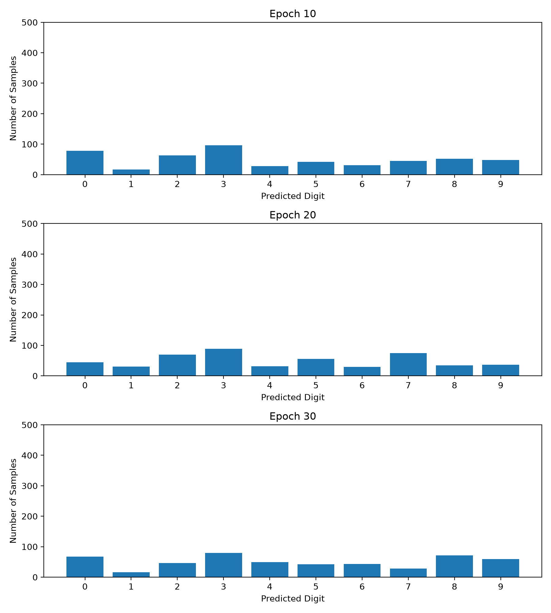

# MNIST Image Generation with Denoising Diffusion Probabilistic Models (DDPM)

A PyTorch implementation of a Denoising Diffusion Probabilistic Model (DDPM) for generating handwritten digits from random Gaussian noise.

This project implements the forward diffusion process, a U-Net-based noise prediction network, reverse diffusion sampling, GPU training, and quantitative evaluation of generated images.

## 1. Project Overview

The goal of this project is to understand and implement the fundamental principles of diffusion-based generative modeling.

The model is trained on the MNIST handwritten digit dataset and learns to reverse a gradual Gaussian noising process to generate new digit images.

**Key features:**

- DDPM implementation using PyTorch
- U-Net-based noise prediction model
- Linear noise variance schedule with 1,000 diffusion steps
- GPU-accelerated training using CUDA
- Reverse diffusion visualization as a GIF
- Comparison of models trained for 10, 20, and 30 epochs
- CNN-based quantitative evaluation
- Reproducible sampling with fixed random seeds

## 2. Mathematical Background

### Forward Diffusion

The forward diffusion process gradually adds Gaussian noise to a clean image.

At each timestep:

$$
q(x_t \mid x_{t-1}) =
\mathcal{N}(x_t;\sqrt{1-\beta_t}x_{t-1},\beta_t I)
$$

where \(\beta_t\) controls the noise variance.

Define:

$$
\alpha_t=1-\beta_t
$$

$$
\bar{\alpha}_t=\prod_{s=1}^{t}\alpha_s
$$

The noisy image at an arbitrary timestep can be sampled directly:

$$
x_t=\sqrt{\bar{\alpha}_t}x_0+
\sqrt{1-\bar{\alpha}_t}\epsilon
$$

where \(\epsilon\sim\mathcal{N}(0,I)\).

### Noise Prediction Objective

The neural network learns to predict the noise added to an image:

$$
\epsilon_\theta(x_t,t)
$$

The training objective minimizes the mean squared error between the actual noise and predicted noise:

$$
\mathcal{L}_{simple}=
\mathbb{E}_{x_0,t,\epsilon}
\left[
\|\epsilon-\epsilon_\theta(x_t,t)\|_2^2
\right]
$$

In the implementation, the loss is calculated using `torch.nn.functional.mse_loss`.

### Reverse Diffusion

Generation begins with random Gaussian noise:

$$
x_T\sim\mathcal{N}(0,I)
$$

The model iteratively predicts and removes noise using:

$$
\mu_\theta(x_t,t)=
\frac{1}{\sqrt{\alpha_t}}
\left(
x_t-\frac{\beta_t}{\sqrt{1-\bar{\alpha}_t}}
\epsilon_\theta(x_t,t)
\right)
$$

The reverse process is sampled as:

$$
x_{t-1}=\mu_\theta(x_t,t)+\sigma_t z
$$

where \(z\sim\mathcal{N}(0,I)\) for \(t>1\), and no additional noise is added at the final step. The implementation uses the DDPM posterior variance for \(\sigma_t^2\).

## 3. Model Architecture

The project uses a lightweight U-Net-based convolutional neural network to predict noise.


**Input:**

- Noisy grayscale image: $1 \times 28 \times 28$
- Diffusion timestep: $t$

**Output:**

- Predicted noise tensor: $1 \times 28 \times 28$


The model contains approximately **533,345 trainable parameters**.

The network is designed for the relatively small image resolution of MNIST, enabling efficient training on a consumer GPU.

## 4. Dataset and Training Configuration

**Dataset:** MNIST

- Training images: 60,000
- Image resolution: 28 × 28
- Channels: 1 (grayscale)
- Normalization range: [-1, 1]

**DDPM training configuration:**

| Parameter | Value |
|---|---|
| Framework | PyTorch |
| Diffusion steps | 1,000 |
| Noise schedule | Linear |
| Beta start | 0.0001 |
| Beta end | 0.02 |
| Optimizer | Adam |
| Learning rate | 0.0002 |
| Batch size | 64 |
| Training epochs | 30 |
| Loss function | Mean Squared Error |
| GPU | NVIDIA GeForce RTX 5060 Laptop GPU |

## 5. Experimental Results

### Training Loss

The DDPM was initially trained for 10 epochs and subsequently continued to 30 epochs.

| Epoch | Average Training MSE |
|---|---|
| 1 | 0.062704 |
| 10 | 0.024973 |
| 30 | 0.023008 |

The training loss decreased substantially during the early epochs and gradually stabilized.



### Generated MNIST Samples

The trained DDPM generates handwritten digit-like images through iterative reverse diffusion.



### Reverse Diffusion Visualization

The reverse diffusion process transforms Gaussian noise into a generated handwritten digit.



Selected intermediate stages:



### Comparison Across Training Epochs

Models trained for 10, 20, and 30 epochs were compared using identical initial noise and sampling randomness.



The visual comparison suggests that additional training can improve digit structure and recognizability, although improvements vary across individual samples.

## 6. Quantitative Evaluation

An independent CNN classifier was trained on MNIST to provide auxiliary evaluation metrics.

The classifier achieved **98.89% accuracy** on the MNIST test set after five training epochs.

Each DDPM checkpoint generated 500 images for evaluation.

### Evaluation Results

| DDPM Epoch | Mean Classifier Confidence |
|---|---|
| 10 | 0.8885 |
| 20 | 0.8786 |
| 30 | **0.9193** |



The 30-epoch model achieved the highest mean classifier confidence among the evaluated checkpoints.

However, classifier confidence is not a direct measure of perceptual quality or sample realism.

### Predicted Class Distribution



All ten digit classes appeared in the classifier predictions, but the predicted distribution was not uniform.

These observations may reflect generative preferences, classifier errors, or sampling variability.

## 7. Installation

Clone the repository:

```bash
git clone https://github.com/YOUR_USERNAME/mnist-ddpm.git
cd mnist-ddpm
```

Create a Conda environment:

```bash
conda create -n mnist-ddpm python=3.11 -y
conda activate mnist-ddpm
```

Install a compatible PyTorch build using the instructions at https://pytorch.org/get-started/locally/.

Install the remaining dependencies:

```bash
pip install -r requirements.txt
```

## 8. Usage

### Test the environment

```bash
python test_environment.py
```

### Train the DDPM

```bash
python train.py
```

### Generate samples

```bash
python sample.py
```

### Visualize reverse diffusion

```bash
python visualize_diffusion.py
```

### Compare checkpoints

```bash
python compare_models.py
```

### Train the independent classifier

```bash
python classifier.py
```

### Evaluate generated images

```bash
python evaluate_ddpm.py
```

**Checkpoint note:** Trained model weights are not included in the repository by default. Sampling, comparison, and evaluation require the corresponding checkpoints. The continuation script also requires a compatible training-state checkpoint containing the optimizer state and loss history.

## 9. Project Structure

```text
mnist-ddpm/
├── model.py
├── train.py
├── resume_train.py
├── sample.py
├── visualize_diffusion.py
├── compare_models.py
├── classifier.py
├── evaluate_ddpm.py
├── test_environment.py
├── requirements.txt
├── .gitignore
├── README.md
└── results/
    ├── generated_digits.png
    ├── reverse_diffusion.gif
    ├── reverse_diffusion_stages.png
    ├── epoch_comparison.png
    ├── training_loss_30epochs.png
    ├── evaluation_metrics.png
    ├── class_distribution.png
    └── evaluation_metrics.csv
```

## 10. Limitations and Future Work

Current limitations include:

- Some generated digits remain distorted or ambiguous.
- The predicted digit distribution is not perfectly balanced.
- Classifier confidence is only an auxiliary evaluation metric.
- The evaluation uses a relatively small number of generated samples.
- The current implementation is unconditional and cannot generate a user-specified digit.

Potential future improvements include:

- Conditional DDPM with digit-label conditioning
- Alternative noise schedules
- DDIM sampling for faster generation
- Exponential moving average (EMA) of model parameters
- More comprehensive generative evaluation metrics

## 11. Conclusion

This project demonstrates an end-to-end implementation of a Denoising Diffusion Probabilistic Model for MNIST image generation.

The experiments show that the model can learn to transform Gaussian noise into recognizable handwritten digits. Additional training reduces the noise prediction loss and improves classifier-based confidence for the final checkpoint, although some limitations in sample quality and class distribution remain.

The project provides a practical foundation for further exploration of diffusion-based generative modeling.

## References

Ho, J., Jain, A., & Abbeel, P. (2020). *Denoising Diffusion Probabilistic Models*. NeurIPS.

https://arxiv.org/abs/2006.11239

LeCun, Y., Cortes, C., & Burges, C. J. C. *The MNIST Database of Handwritten Digits*.

https://yann.lecun.com/exdb/mnist/